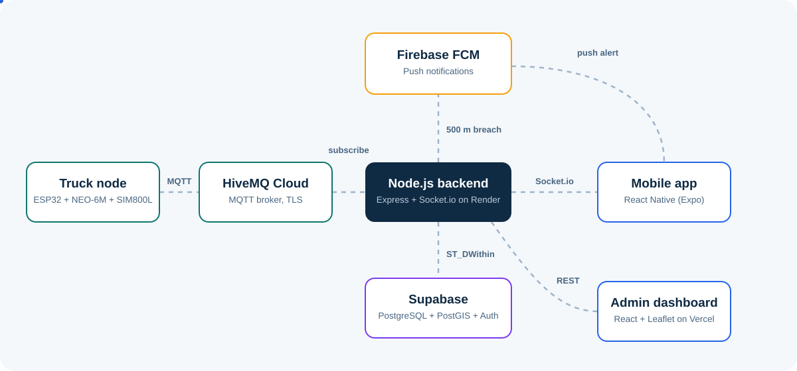
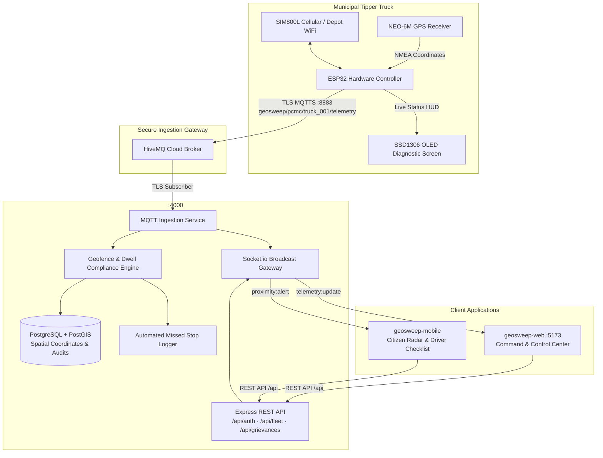

# GeoSweep · Municipal Solid Waste Collection & Fleet Accountability Platform

<div align="center">



[](https://swachhbharaturban.gov.in/)
[](https://www.pcmcindia.gov.in/)
[](https://github.com/GeoSweep)
[](https://github.com/GeoSweep/geosweep-backend)
[](https://github.com/GeoSweep/geosweep-web)
[](https://github.com/GeoSweep/geosweep-mobile)
[](https://github.com/GeoSweep/geosweep-firmware)

</div>

> **GeoSweep** is an industrial-grade, IoT-powered municipal solid-waste collection, automated geofencing, route compliance verification, approach notification radar, and operational accountability platform engineered for **Urban Local Bodies (ULBs)**, **Smart City Administrations**, and **Citizens**.

---


## 🏛️ Executive Summary & Civic Vision

Under the **Swachh Bharat Mission (Urban 2.0)** and **National Smart Cities Mission**, 100% door-to-door solid waste collection and verifiable municipal fleet tracking are statutory mandates. However, municipal administrators and citizens across Urban Local Bodies routinely face critical systemic bottlenecks:

1. **Unpredictable Collection Windows:** Citizens miss collection tipper trucks due to irregular arrival times, resulting in roadside littering and unsegregated dumping.
2. **"Skip-and-Run" Route Non-Compliance:** Collection vehicles bypass society gates or depart in less than 30 seconds without allowing residents sufficient time to deposit segregated waste.
3. **Unverified Manual Logbooks:** Traditional paper logs or static RFID tags lack spatial-temporal verification and are susceptible to manual manipulation.
4. **Lack of Executive Command Visibility:** Ward officers and sanitary inspectors lack unified, real-time spatial dashboards to detect skipped societies, unauthorized diversions, or delayed routes.

**GeoSweep eliminates these inefficiencies** through an automated, end-to-end cyber-physical pipeline connecting on-vehicle IoT GPS/GSM tracking units, spatial post-processing algorithms (PostGIS), a 500-meter citizen approach radar, and an executive municipal command center.

---

## 🌟 The Five Civic Pillars of GeoSweep

```
┌─────────────────────────────────────────────────────────────────────────────────┐
│                           GEOSWEEP 5-PILLAR ARCHITECTURE                         │
├─────────────────────┬─────────────────────┬─────────────────────────────────────┤
│ 🛰️ 1. IoT Edge Node │ 📡 2. Cloud Broker  │ 🧭 3. Automated Dwell Verification  │
│ Hardware mounted in │ High-throughput     │ Real-time geofence engine enforcing │
│ municipal tippers;  │ TLS MQTTS telemetry │ mandatory 180s dwell time at each   │
│ GPS + GSM failover. │ ingestion & buffer. │ society gate before clearing stop.  │
├─────────────────────┴─────────────────────┼─────────────────────────────────────┤
│ 📊 4. Swachh Command & Control Center     │ 📱 5. Citizen Radar & Driver App    │
│ Municipal GIS dashboard with live vehicle │ Dual-role mobile application with   │
│ trails, speed telemetry, & ward KPI cards.│ 500m proximity radar & stop lists.  │
└───────────────────────────────────────────┴─────────────────────────────────────┘
```

### 1. 🛰️ Vehicle IoT Telemetry Edge Unit (`geosweep-firmware`)
- Physical tracking device deployed in municipal collection tippers.
- **Microcontroller:** ESP32 dual-core Xtensa processor running non-blocking FreeRTOS telemetry tasks.
- **Positioning:** NEO-6M high-sensitivity GNSS receiver parsing NMEA sentences (lat, lng, speed, heading, satellite fix).
- **Dual-Link Connectivity:** Primary GSM/GPRS (SIM800L) with automatic fallback to municipal depot WiFi.
- **Driver Diagnostics:** On-chassis SSD1306 OLED HUD displaying live GPS coordinate lock, network signal, and MQTT broker handshake status.

### 2. ⚡ Secure Cloud Broker & Spatial Pipeline (`geosweep-backend`)
- **Transport Security:** Secure TLS 8883 MQTTS encryption preventing telemetry interception or spoofing.
- **Database Engine:** PostgreSQL with **PostGIS** spatial extensions for sub-meter geodetic distance calculations (`ST_DWithin`, `ST_MakePoint`).
- **Telemetry Processing:** Ingestion service with geodetic deduplication, route spatial snapping, and automated speed anomaly detection.
- **Real-Time Distribution:** Scalable WebSocket streams (`Socket.io`) broadcasting live coordinates to municipal control rooms and citizen mobile applications.

### 3. ⏱️ Automated Geofence Dwell Compliance Enforcement
- Eliminates fake collection logs by programmatically verifying that a vehicle stayed within a society's designated geofence perimeter for a **mandatory minimum dwell duration (180 seconds)**.
- If a driver leaves early, the stop is flagged as **`INCOMPLETE_DWELL`** and logged in the municipal audit trail.
- If a driver bypasses a designated society, an automated **`MISSED_STOP`** incident alert is instantly triggered to the zonal Sanitary Inspector.

### 4. 🖥️ Swachh Command & Control Center (`geosweep-web`)
- Enterprise web portal engineered for Municipal Commissioners, Zonal Officers, and Sanitary Inspectors.
- **Live GIS Fleet Radar:** Real-time OpenStreetMap rendering vehicle movement, speed indicators, heading bearings, and collection route progress.
- **Municipal Scope Filters:** Multi-tenant hierarchy (City → Zone → Ward → Society) with granular data isolation.
- **Actionable Municipal KPIs:** Live fleet availability percentage, average dwell compliance rate, active grievance tickets, and total tonnage estimates.

### 5. 📱 Dual-Role Mobile Portal (`geosweep-mobile`)
- **For Citizens:**
  - **500m Proximity Radar:** Visual animated radar pulse and notification when the assigned collection truck crosses the 500m society radius.
  - **Fixed Society Anchor:** Saves citizen society address with animated geofence boundary identical to the municipal GIS map.
  - **1-Tap Grievance Logging:** Direct grievance submission to PCMC Smart City Command with automated photo and timestamp attachment.
- **For Drivers:**
  - **Sequential Route Checklist:** Turn-by-turn collection sequence with real-time dwell timer countdown.
  - **Vehicle Health HUD:** Battery voltage, satellite count, and depot departure logging.

---

## 🔄 End-to-End System Data Flow

<div align="center">



</div>



---

## 🔒 Data Privacy, Security & Governance

GeoSweep adheres to modern e-Governance standards and the **Digital Personal Data Protection (DPDP) Act**:

- **Municipal Scope Enforcement:** Role-Based Access Control (RBAC) ensures Sanitary Inspectors only access data within their assigned Ward, while Society Secretaries only see their specific collection schedule.
- **Zero Citizen PII Broadcast:** Telemetry streams broadcast only vehicle coordinates and public stop landmarks; personal resident details are never broadcast over WebSocket channels.
- **End-to-End Encryption:** All telemetry in transit is secured using **TLS 1.3** and certificate-authenticated MQTTS connections.
- **Immutable Audit Trail:** All trip start events, stop collections, bypass incidents, and grievance resolutions are time-stamped with cryptographically verifiable records for municipal compliance audits.

---

## 📁 Repository Directory

GeoSweep is developed as an integrated polyrepo under the [GeoSweep GitHub Organization](https://github.com/GeoSweep):

| Repository | GitHub Path | Stack | Role |
| :--- | :--- | :--- | :--- |
| **`geosweep-workspace`** | [`GeoSweep/geosweep-workspace`](https://github.com/GeoSweep/geosweep-workspace) | npm workspaces, concurrently | Central developer workspace, orchestration, and root repository |
| **`geosweep-backend`** | [`GeoSweep/geosweep-backend`](https://github.com/GeoSweep/geosweep-backend) *(Private)* | Node.js, Express, TypeScript, PostGIS, Socket.io | Core telemetry ingestion, geofence compliance, REST API |
| **`geosweep-web`** | [`GeoSweep/geosweep-web`](https://github.com/GeoSweep/geosweep-web) *(Private)* | React, Vite, TypeScript, Leaflet, Tailwind CSS | Municipal command & control center, fleet tracking GIS map |
| **`geosweep-mobile`** | [`GeoSweep/geosweep-mobile`](https://github.com/GeoSweep/geosweep-mobile) *(Private)* | React Native, Expo SDK, TypeScript | Citizen 500m proximity radar & Driver sequential stop checklist |
| **`geosweep-firmware`** | [`GeoSweep/geosweep-firmware`](https://github.com/GeoSweep/geosweep-firmware) *(Private)* | C++, PlatformIO, Arduino, TinyGSM, TinyGPSPlus | On-vehicle physical IoT tracking hardware unit |

---

## ⚡ Developer Quickstart

The master workspace provides developer orchestration to start the municipal platform locally:

### 1. Clone the Master Workspace
```bash
git clone https://github.com/GeoSweep/geosweep-workspace.git GeoSweep
cd GeoSweep
```

### 2. Configure Environment Variables
Copy `.env.example` to `.env` and fill in your Supabase, HiveMQ, and municipal configuration keys:
```bash
cp .env.example .env
```

### 3. Install Workspace Dependencies
```bash
npm install
```

### 4. Launch Backend & Web Command Center Concurrently
```bash
npm run dev
```
*Runs **Backend API & Telemetry Engine** on `http://localhost:4000` and **Web Command Center** on `http://localhost:5173` simultaneously.*

### 5. Launch Mobile Application (Separate Terminal)
```bash
npm run dev:mobile
# or: cd geosweep-mobile && npx expo start
```
*Press `a` to run on Android Emulator (e.g. Pixel 9) or scan the QR code using the Expo Go mobile app.*

---

## 🛠️ Workspace Commands

| Command | Action |
| :--- | :--- |
| `npm run dev` | **Runs both Node.js Backend and React Web Dashboard concurrently** |
| `npm run dev:backend` | Runs only `geosweep-backend` on port `4000` |
| `npm run dev:web` | Runs only `geosweep-web` on port `5173` |
| `npm run dev:mobile` | Starts the `geosweep-mobile` Expo development server |
| `npm run build` | Builds production bundles for backend and web |
| `npm run typecheck` | Strict TypeScript compilation checks across all services (0 errors) |
| `npm test` | Executes backend unit and integration test suites |

---

## 🇮🇳 Swachh Bharat Mission (SBM-Urban 2.0) Alignment Matrix

| SBM-Urban 2.0 Statutory Directive | GeoSweep Feature Implementation |
| :--- | :--- |
| **100% Door-to-Door Collection Tracking** | GPS/GSM edge telemetry with automated society-level stop detection. |
| **Verification of Waste Deposition** | 180-second mandatory dwell-time geofence enforcement preventing bypassed gates. |
| **Citizen Engagement & Transparent ETAs** | 500-meter proximity radar notifications with live map tracking. |
| **Citizen Grievance Redressal Mechanism** | 1-tap mobile grievance filing with verifiable timestamp and vehicle coordinate correlation. |
| **Municipal Fleet Route Optimization** | Turn-by-turn sequential driver stop checklist and real-time deviation alerts. |

---

<div align="center">

**GeoSweep · Driving Digital Accountability in Urban Solid Waste Management**

*Designed for Smart Cities, Urban Local Bodies, and Citizens.*

</div>
