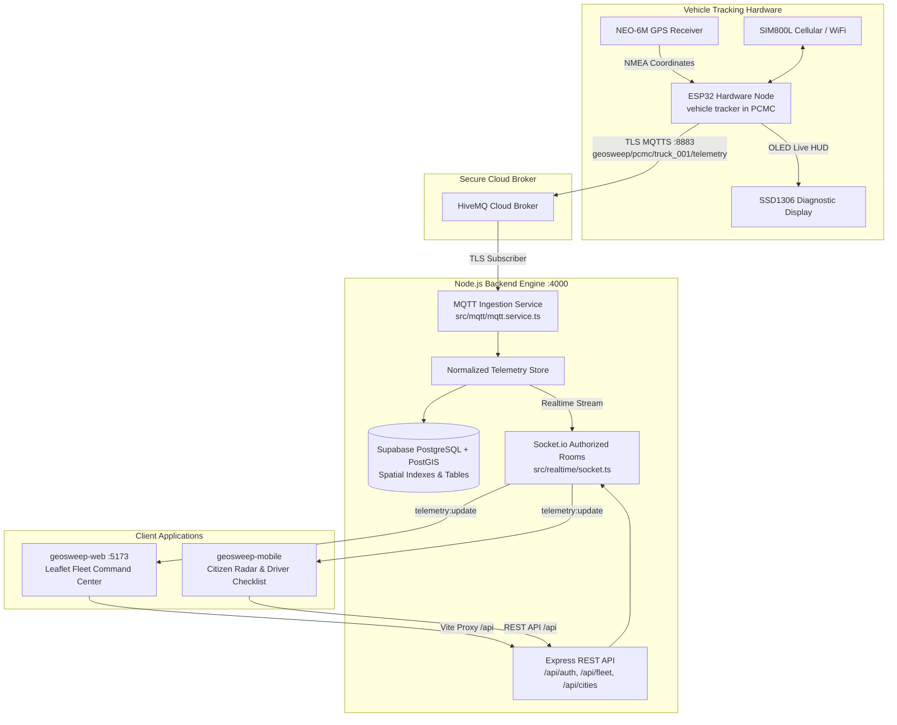

# GeoSweep

[](https://github.com/GeoSweep)
[](https://github.com/GeoSweep/geosweep-backend)
[](https://github.com/GeoSweep/geosweep-web)
[](https://github.com/GeoSweep/geosweep-mobile)
[](https://github.com/GeoSweep/geosweep-firmware)
[](https://supabase.com/)
[](https://www.hivemq.com/)

> **Industrial-grade, IoT-powered municipal solid-waste collection, automated geofencing, route compliance verification, approach notification radar, and operational accountability platform for Urban Local Bodies (ULBs).**

---

## 🏛️ Polyrepo Architecture & Repository Directory

GeoSweep is organized as an enterprise polyrepo under the [GeoSweep GitHub Organization](https://github.com/GeoSweep). Each component is independently versioned, typed, tested, and deployable:

| Repository | GitHub URL | Technology Stack | Core Responsibility |
| :--- | :--- | :--- | :--- |
| **`geosweep-backend`** | [`GeoSweep/geosweep-backend`](https://github.com/GeoSweep/geosweep-backend) | Node.js, Express, TypeScript, Supabase PostGIS, Socket.io, HiveMQ | Telemetry ingestion, data normalization, RBAC & municipal scope enforcement, REST API, WebSocket streams |
| **`geosweep-web`** | [`GeoSweep/geosweep-web`](https://github.com/GeoSweep/geosweep-web) | React 18, Vite, TypeScript, Tailwind CSS, Leaflet, Lucide React | Municipal command center, real-time vehicle radar, route/stop planner, and public citizen landing page |
| **`geosweep-mobile`** | [`GeoSweep/geosweep-mobile`](https://github.com/GeoSweep/geosweep-mobile) | React Native, Expo SDK, TypeScript, Firebase Cloud Messaging | Citizen 500m approach radar notifications, society ETA, and driver sequential stop collection checklist |
| **`geosweep-firmware`**| [`GeoSweep/geosweep-firmware`](https://github.com/GeoSweep/geosweep-firmware) | ESP32 C++, PlatformIO, Arduino, TinyGSM, TinyGPSPlus | Physical vehicle tracking unit, GPS NMEA parsing, cellular SIM800L / WiFi failover, OLED diagnostics |
| **`geosweep-workspace`**| [`GeoSweep/geosweep-workspace`](https://github.com/GeoSweep/geosweep-workspace) | npm workspaces, concurrently | Central developer workspace, multi-service dev orchestration, and master development roadmap |

---

## 🛰️ End-to-End System Data Flow



---

## ⚡ Quickstart: Running the Entire Platform Locally

The root workspace includes unified developer orchestration with `concurrently`. You can start both the backend and web dashboard simultaneously:

```bash
# 1. Clone the master workspace
git clone https://github.com/GeoSweep/geosweep-workspace.git GeoSweep
cd GeoSweep

# 2. Install workspace dependencies
npm install

# 3. Start both Backend (:4000) and Web (:5173) with a single command:
npm run dev
```

### Available Root Commands

| Command | Action |
| :--- | :--- |
| `npm run dev` | **Runs both Node.js Backend and React Web Dashboard concurrently** |
| `npm run dev:backend` | Runs only `geosweep-backend` on port `4000` |
| `npm run dev:web` | Runs only `geosweep-web` on port `5173` |
| `npm run build` | Builds production artifacts for both backend and web |
| `npm run typecheck` | Strict TypeScript compilation checks across all TypeScript code |
| `npm test` | Runs backend unit and integration test suite |

---

## 📋 Phased Implementation Roadmap

GeoSweep is developed following a rigorous 18-phase implementation specification documented in [`PHASES.md`](./PHASES.md):

- [x] **Phase 00:** Polyrepo & Developer Foundation
- [x] **Phase 01:** Supabase Database & Schema Foundation (PostGIS)
- [o] **Phase 02:** Authentication, Profiles, RBAC & Scope Enforcement
- [o] **Phase 03:** Super Admin & Municipal Tenant Onboarding
- [o] **Phase 04:** Zones, Wards, Societies & Scope Filters
- [o] **Phase 05:** Fleet & Device Registry
- [o] **Phase 06:** Routes & Collection Stops (Spatial Ordering)
- [o] **Phase 07:** Admin Dashboard & Route-Planning Map
- [o] **Phase 08:** Telemetry Simulator & Data Normalization
- [o] **Phase 09:** Realtime Updates with Socket.io
- [ ] **Phase 10:** Geofencing, Approach Events & Incidents
- [x] **Phase 11:** Physical MQTT & ESP32 Integration (Live Hardware Verified)
- [ ] **Phase 12:** Push Notifications (Firebase FCM)
- [ ] **Phase 13:** Mobile Applications (Citizen & Driver Expo Apps)
- [o] **Phase 14:** Reports, Audit Trail & Accountability
- [o] **Phase 15:** Public Website & Landing Presentation
- [ ] **Phase 16:** Production Hardening & Deployment
- [ ] **Phase 17:** Controlled Real-World Municipal Pilot

---

## 📖 Architecture Decision Records (ADRs)

Architecture decisions are documented under [`docs/decisions/`](./docs/decisions/):
- [`0001-monorepo-and-technology-stack.md`](./docs/decisions/0001-monorepo-and-technology-stack.md): Polyrepo structure, Node.js + Express, Supabase PostGIS, React/Vite, React Native/Expo, and ESP32 PlatformIO stack commitment.
